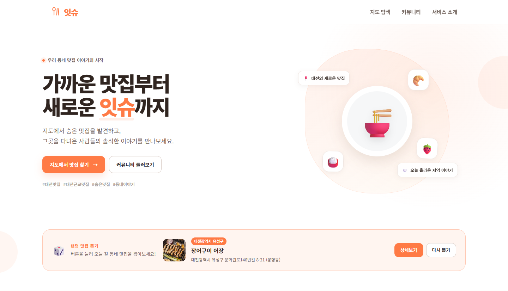
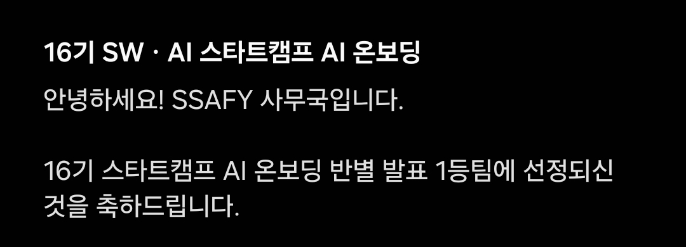
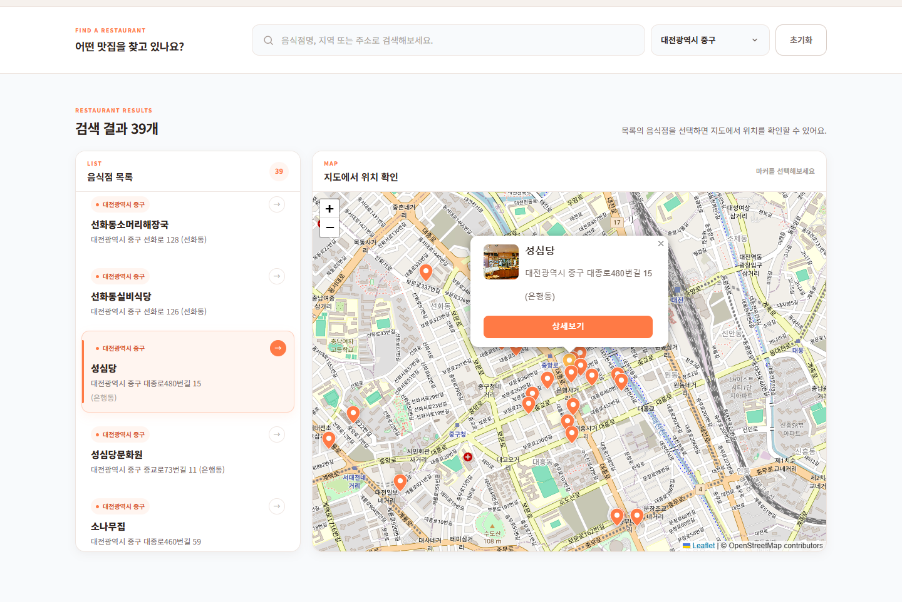
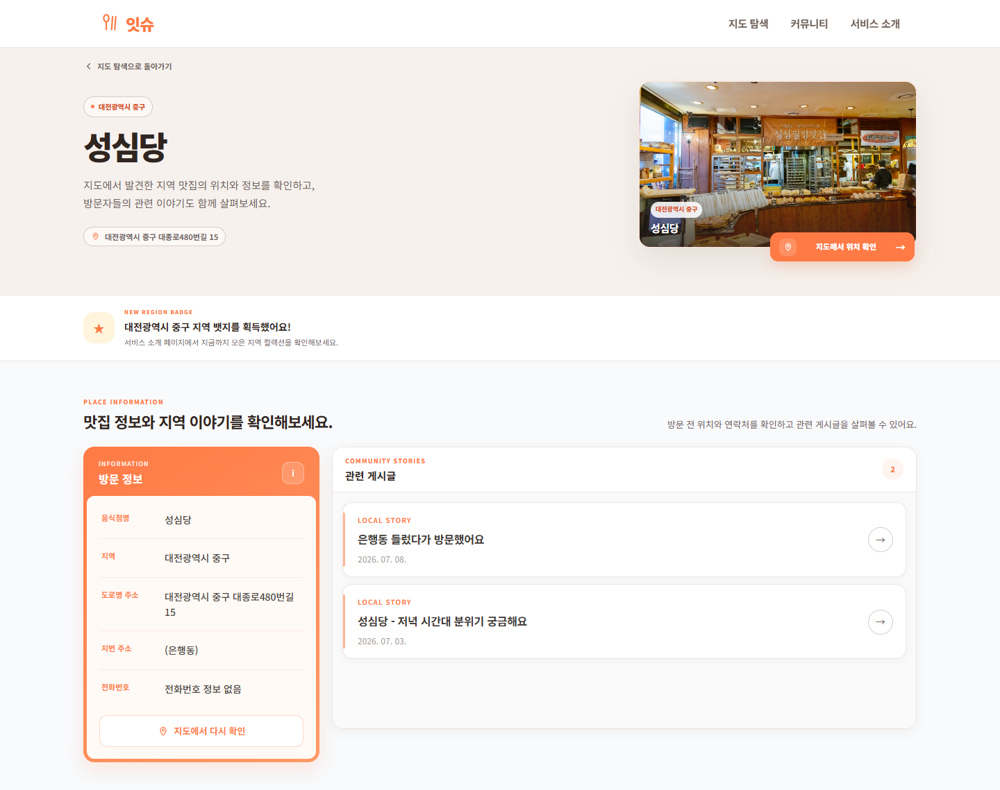
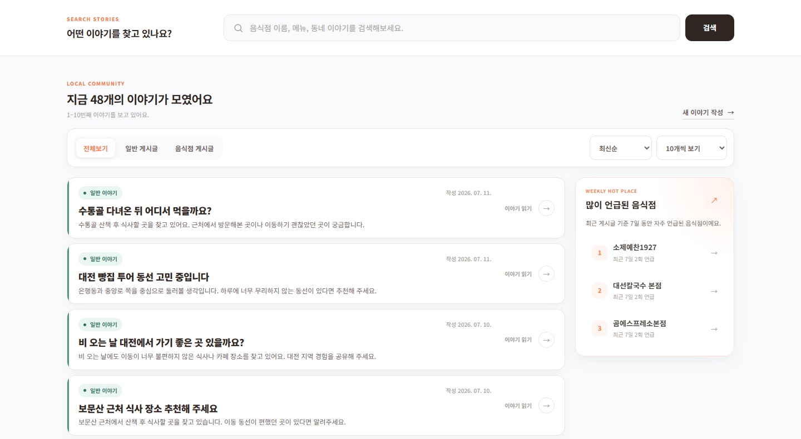
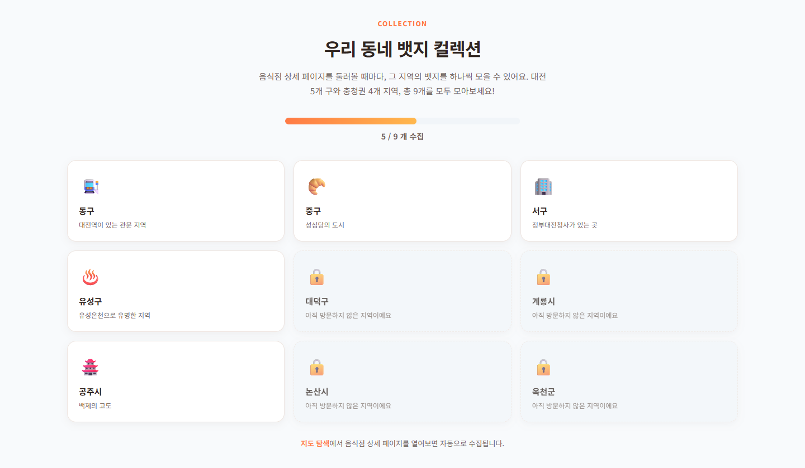
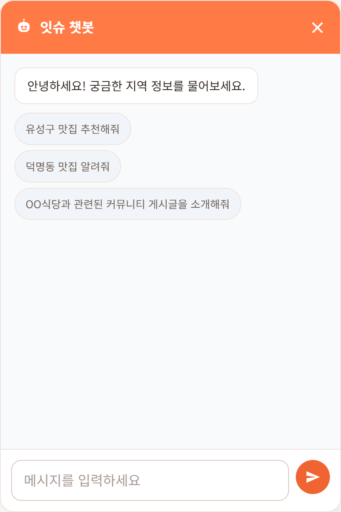
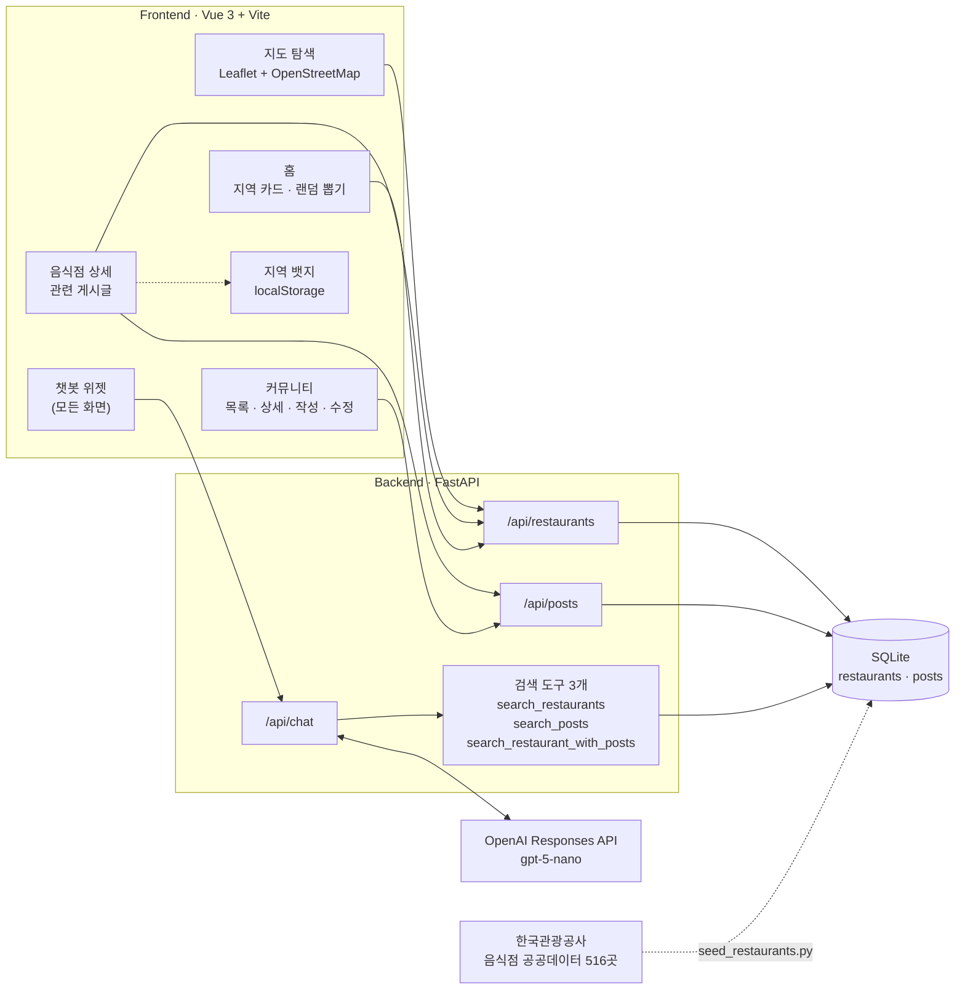
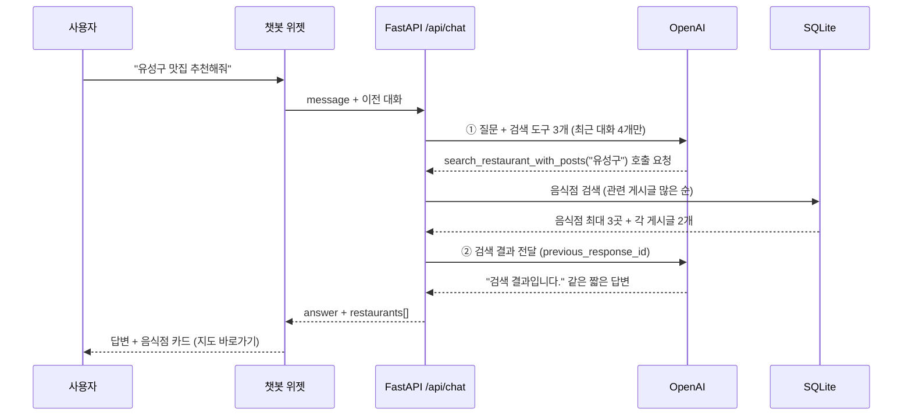

# 🍽️ 잇슈 — 대전·충청 맛집 지도 × 익명 커뮤니티 × AI 챗봇

**SSAFY 16기 SW·AI 스타트캠프 AI 온보딩 프로젝트**(2026.07.14 \~ 07.16, 3일 · 팀 잇슈 3명) · 🏆 **반별 발표 1등**




대전·충청권 음식점 **516곳**을 지도에서 찾아보고, 그 음식점에 대한 이야기를 **회원가입 없이 익명으로** 나누는 지역 기반 맛집 커뮤니티입니다.
음식점 정보는 어디서나 볼 수 있지만 "지금 가도 되는지", "주차는 어떤지" 같은 동네 사람들의 이야기는 흩어져 있었습니다.
그래서 **지도 · 음식점 상세 · 커뮤니티 게시글 · 챗봇**을 하나의 흐름으로 묶는 데 집중했고, 챗봇은 LLM이 지어내지 않도록 **DB 검색 결과로만 답하게** 설계했습니다.

| 항목 | 내용 |
|---|---|
| 기간 | 2026.07.14 \~ 07.16 (3일) |
| 팀 | 잇슈 · 3명 (Frontend 2, Backend 1) |
| 결과 | 🏆 **반별 발표 1등** (16기 스타트캠프 AI 온보딩) |
| 데이터 | 한국관광공사 음식점 공공데이터 **516곳** (대전 360 · 충남 118 · 충북 38) |
| 협업 | GitLab · 기능 브랜치 13개 · dev 병합 MR 21회 · 커밋 45개 (병합 제외) |
| 내 역할 | Frontend — 지도 탐색, 음식점 상세, 챗봇 UI, 서비스 소개 페이지, 지역 뱃지·랜덤 뽑기 |

**수상 안내 (SSAFY 사무국)**



### 핵심 성과

- **지도와 이야기를 한 흐름으로 연결**: 마커 → 음식점 상세 → 그 음식점의 게시글로 이어지고, 반대로 상세 페이지·챗봇 답변에서 지도의 해당 마커로 바로 돌아옵니다.
  화면마다 따로 놀던 정보를 클릭 한 번으로 오가게 했습니다.
- **지어내지 않는 챗봇**: LLM이 바로 답하지 않고 DB 검색 도구 3개 중 필요한 것을 골라 호출한 뒤, 검색 결과만 근거로 답합니다.
  평점 데이터가 없기 때문에 "인기 순위" 같은 표현도 프롬프트에서 막았습니다.
- **LLM 답변을 안전하고 쓸모 있게 렌더링**: 답변을 먼저 HTML 이스케이프해 XSS를 막고, 답변 속 음식점 이름을 실제 DB 이름과 대조해 **지도 바로가기 버튼**으로 바꿨습니다.
- **다시 오게 만드는 장치**: 음식점 상세를 볼 때마다 그 지역 뱃지(9종)를 모으는 컬렉션과 랜덤 맛집 뽑기를 넣어, 탐색 자체가 놀이가 되게 했습니다.

---

## 목차

1. [기획 배경](#1-기획-배경)
2. [주요 기능](#2-주요-기능)
3. [시스템 구조](#3-시스템-구조)
4. [핵심 구현](#4-핵심-구현)
5. [팀 구성과 역할](#5-팀-구성과-역할)
6. [협업 방식](#6-협업-방식)
7. [주요 의사결정](#7-주요-의사결정)
8. [회고](#8-회고)
9. [실행 방법](#9-실행-방법)
10. [API 명세](#10-api-명세)
11. [데이터 출처](#11-데이터-출처)

---

## 1. 기획 배경

| 문제 | 잇슈의 접근 |
|---|---|
| 지도 위의 정보는 많은데, 이야기는 없음 | 지도와 커뮤니티를 한 화면 흐름으로 묶어 위치 정보와 사람들의 이야기를 함께 보여줌 |
| 후기 하나 남기려고 회원가입까지 하기는 부담스러움 | 로그인 없이 제목·내용·비밀번호만으로 글을 쓰고, 같은 비밀번호로 수정·삭제 |
| 맛집 앱은 리뷰 중심이라 동네 이야기를 나누기 어려움 | 게시글을 **음식점 게시글**(특정 음식점과 연결)과 **일반 게시글**(자유로운 동네 이야기)로 구분 |
| 원하는 조건으로 찾으려면 검색을 여러 번 해야 함 | "유성구 맛집 추천해줘"처럼 말로 물어보는 챗봇 |

---

## 2. 주요 기능

| 기능 | 설명 |
|---|---|
| 🗺️ **지도 탐색** | Leaflet 지도에 음식점 516곳을 마커로 표시. 이름·주소 검색, 지역 필터, 목록 클릭 시 해당 마커로 이동 |
| 📍 **음식점 상세** | 주소·이미지와 함께 그 음식점에 연결된 커뮤니티 게시글을 한 화면에서 확인. "지도에서 위치 확인"으로 지도 복귀 |
| 💬 **익명 커뮤니티** | 로그인 없이 작성. 일반 / 음식점 게시글, 비밀번호로 수정·삭제 |
| 🔎 **검색·필터·정렬** | 제목·내용·음식점명 검색, 전체 / 일반 / 음식점 필터, 최신순 / 오래된순, 페이지 크기(10·20·30), 숫자 페이지네이션 |
| 🔥 **최근 많이 언급된 음식점** | 최근 7일 동안 게시글에서 가장 많이 언급된 음식점 TOP 3 |
| 🤖 **AI 챗봇** | 지역·음식점명으로 질문하면 DB에서 찾은 음식점을 카드로 보여주고, 카드에서 지도로 바로 이동 |
| 🏅 **지역 뱃지 컬렉션** | 음식점 상세를 열면 그 지역(대전 5개 구 + 충청권 4개 시·군) 뱃지를 자동 수집 |
| 🎲 **랜덤 맛집 뽑기** | 홈 화면에서 슬롯처럼 돌아가는 연출로 오늘 갈 맛집을 하나 뽑기 |

### 화면

**지도 탐색** — 지역 필터로 대전 중구 39곳을 고르고, 목록에서 성심당을 선택하면 지도의 마커 팝업이 열립니다.



**음식점 상세** — 처음 보는 지역이면 뱃지 획득 안내가 뜨고, 그 음식점에 연결된 커뮤니티 게시글이 함께 보입니다.



**커뮤니티** — 전체 / 일반 / 음식점 게시글 필터, 정렬, 페이지 크기 선택, 오른쪽에 최근 7일 동안 많이 언급된 음식점 TOP 3.



**지역 뱃지 컬렉션** — 음식점 상세를 둘러본 지역의 뱃지가 열리고, 수집 진행률이 표시됩니다.



**챗봇 위젯** — 모든 화면 오른쪽 아래에서 열 수 있고, 추천 질문을 눌러 바로 물어볼 수 있습니다.



**사용 흐름**

```
홈 ─ 지역 카드 클릭 ─▶ 지도 탐색(/map?keyword=유성구)
                          │ 마커 팝업 "상세보기"
                          ▼
                     음식점 상세 ─── 관련 게시글 ───▶ 게시글 상세 / 작성
                          │ (지역 뱃지 자동 수집)
                          └─ "지도에서 위치 확인" ─▶ 지도(/map?focus=<id>)

어느 화면에서든 ─ 챗봇 ─ "유성구 맛집 추천해줘" ─▶ 음식점 카드 ─▶ 지도(/map?focus=<id>)
```

---

## 3. 시스템 구조



**데이터 모델**

```
restaurants                                  posts
─────────────────────────────                ─────────────────────────────────────
content_id  PK (관광공사 고유 ID)  ◀──────┐   id           PK
title       음식점명                     └── restaurant_id FK, NULL 허용 (일반 게시글)
addr1/addr2 주소                               ON DELETE SET NULL
mapx/mapy   경도/위도                         title / content
l_dong_regn_cd / l_dong_signgu_cd 법정동 코드   password     수정·삭제용
firstimage  대표 이미지                        created_at / updated_at
```

---

## 4. 핵심 구현

### 4-1. 지도 ↔ 상세 ↔ 게시글 연결 (담당)

- **목록과 지도 동기화**: 목록에서 음식점을 고르면 지도가 해당 마커로 이동하고 팝업이 열립니다. 선택된 마커는 색을 바꿔 구분합니다.
- **어디서 들어와도 같은 마커로**: 상세 페이지와 챗봇은 `/map?focus=<id>`로 지도를 엽니다.
  이미 지도 화면에 있을 때는 라우트가 그대로라 `onMounted`가 다시 실행되지 않으므로, `route.query.focus`를 `watch`해서 다시 포커스합니다. 포커스 후에는 쿼리를 지워 새로고침해도 같은 동작이 반복되지 않게 했습니다.
- **API 응답 정규화**: 백엔드가 준비되기 전에는 임시 JSON으로 지도 화면을 먼저 만들었습니다.
  API 연동 때는 `content_id / title / mapx / mapy`를 `id / name / lng / lat`으로 바꾸는 정규화 함수 한 곳만 고쳐서, 화면 코드는 그대로 두고 전환했습니다.

### 4-2. 데이터에 근거한 챗봇 (Backend · Function Calling)

LLM이 음식점을 직접 떠올려 답하면 없는 가게나 평점을 지어낼 수 있습니다. 그래서 LLM의 역할을 **"어떤 검색을 할지 고르고, 결과를 짧게 설명하기"** 로 좁혔습니다.



- **검색 도구 3개**: 음식점 검색 / 게시글 검색 / 음식점 + 연결 게시글 통합 검색. LLM은 질문에 맞는 도구와 키워드만 고릅니다.
- **정렬 기준을 정직하게**: 평점 데이터가 없으므로 "관련 게시글이 많은 순"으로 정렬하고, 이것이 **인기 순위가 아니라는 점**을 시스템 프롬프트에 명시했습니다.
- **목록은 UI가, 설명은 LLM이**: 음식점 목록은 구조화된 `restaurants[]`로 내려 카드로 그리고, LLM 답변에서는 목록을 반복하지 않게 했습니다.
- **토큰 절약**: 이전 대화는 최근 4개·각 500자, 게시글 본문은 250자, 음식점 3곳·게시글 2개로 잘라서 보냅니다.

### 4-3. 챗봇 답변 렌더링 (담당)

| 문제 | 해결 |
|---|---|
| LLM 답변을 `v-html`로 그대로 넣으면 XSS 위험 | 먼저 `& < >`를 이스케이프하고, 굵게·목록·문단만 허용된 태그로 변환. 답변에 태그가 섞여 있어도 텍스트로만 표시됨 |
| 답변 속 음식점 이름을 눌러 바로 지도로 가고 싶음 | 실제 DB 음식점 이름과 대조해 지도 링크 버튼으로 치환. **긴 이름부터** 치환해 짧은 이름이 긴 이름의 일부를 먼저 가로채지 않게 함 |
| LLM이 `게시글 ID: 12`, `제목: …`, `내용: …` 같은 줄을 섞어 씀 | 이 줄들을 파싱해 게시글 카드(최대 3개)로 분리하고, ID·내용 줄은 화면에서 제거 |
| LLM 응답이 일반 API보다 느림 | 챗봇 요청만 타임아웃 30초, 타이핑 애니메이션, 추천 질문 버튼 |
| 음식점 이름 목록을 못 불러오면? | 지도 링크는 부가 기능이므로, 실패해도 챗봇 대화는 그대로 동작 |

### 4-4. 익명 커뮤니티와 최근 많이 언급된 음식점

- **익명 CRUD**: 글마다 비밀번호를 저장하고, 수정·삭제 요청의 비밀번호가 다르면 `403`을 반환합니다.
- **두 종류의 게시글**: `restaurant_id`가 있으면 음식점 게시글, 없으면 일반 게시글입니다. 음식점이 삭제돼도 게시글은 남도록 `ON DELETE SET NULL`로 설정했습니다.
- **최근 7일 TOP 3**: 음식점 게시글을 음식점별로 세고, 같으면 더 최근에 언급된 곳을 위에 둡니다.
  기준 시점을 "오늘"이 아니라 **가장 최근 게시글 시각**으로 잡아, 글이 뜸한 기간에도 목록이 비지 않게 했습니다.

### 4-5. 지역 뱃지 컬렉션과 랜덤 뽑기 (담당)

- **뱃지 9종**: 데이터셋에 실제로 있는 지역(대전 5개 구 + 계룡·공주·논산·옥천)만 뱃지로 만들었습니다. 음식점 상세를 열면 그 지역 뱃지가 자동으로 수집되고, 처음 얻을 때만 "새로 획득" 연출이 나옵니다.
- **로그인 없는 상태 저장**: 사용자 계정이 없으므로 수집 상태는 `localStorage`에 둡니다.
  상태를 모듈 스코프의 `reactive` 하나로 만들어, 상세 페이지와 소개 페이지가 같은 상태를 공유하고 서로 즉시 반영되게 했습니다.
- **랜덤 맛집 뽑기**: 1.2초 동안 80ms 간격으로 음식점이 바뀌는 슬롯 연출 후 하나를 고르고, 직전 결과는 다시 나오지 않게 했습니다.

---

## 5. 팀 구성과 역할

| 이름 | 역할 | 담당 |
|---|---|---|
| **김순하 (본인)** | Frontend | 지도 탐색(Leaflet 마커·팝업·포커스), 지도·마커 API 연동, 음식점 상세·관련 게시글, 챗봇 UI, 서비스 소개 페이지, 지역 뱃지·랜덤 뽑기 |
| 김지유 | Frontend | Vue 프로젝트 구조, 홈·헤더, 커뮤니티(목록·상세·작성·수정), 검색·필터·정렬·페이지네이션, 최근 7일 인기 음식점, 전체 디자인 |
| 박세림 | Backend | DB 모델링·음식점 데이터 적재, 음식점·게시글 API, OpenAI 챗봇(Function Calling·시스템 프롬프트), 샘플 게시글 데이터 |

**내가 작성한 주요 파일**

```
frontend/src/
├── components/restaurant/RestaurantMap.vue   Leaflet 지도, 마커·팝업, 선택 마커 포커스
├── components/restaurant/TodayPickCard.vue   랜덤 맛집 뽑기
├── components/chat/ChatWidget.vue            챗봇 위젯, 안전한 답변 렌더링, 지도 링크 변환
├── composables/useRegionBadges.js            지역 뱃지 상태 (localStorage)
├── views/RestaurantExploreView.vue           지도 탐색 화면, 검색·지역 필터, ?focus 처리
├── views/RestaurantDetailView.vue            음식점 상세, 관련 게시글, 뱃지 수집
├── views/AboutView.vue                       서비스 소개, 뱃지 컬렉션
└── api/restaurantApi.js                      음식점 API, 응답 정규화
```

---

## 6. 협업 방식

- **브랜치 전략**: `feat/*` → `dev` → `master`. 기능 단위로 브랜치를 나누고 GitLab MR로 `dev`에 병합했습니다(기능 브랜치 13개, MR 21회).
- **병렬 작업**: 백엔드 API가 나오기 전에 프론트는 임시 데이터와 화면을 먼저 만들고, API가 나오는 대로 기능별로 연동했습니다.

| 날짜 | Frontend | Backend |
|---|---|---|
| **Day 1** (07.14) | 기획 · 역할 분담 | 기획 · 역할 분담 |
| **Day 2** (07.15) | 프로젝트 구조, Leaflet 지도·마커, 게시글 목록·작성·수정 화면, 챗봇 UI, 지도·커뮤니티 API 연동, 마커 내 관련 게시글 | DB 설계·음식점 데이터 적재, 음식점·게시글 API |
| **Day 3** (07.16) | 홈 화면, 서비스 소개·지역 뱃지, 챗봇 기능 연결과 UI 개선, 전체·커뮤니티 디자인 통일 | 스키마 정리, OpenAI 챗봇(Function Calling), 시스템 프롬프트·토큰 절약, 샘플 게시글 |

---

## 7. 주요 의사결정

| 결정 | 근거 | 결과 |
|---|---|---|
| 회원가입 없는 익명 + 글별 비밀번호 | 3일 일정 안에서 인증보다 핵심 경험에 집중, 후기 작성 장벽 낮추기 | 로그인 없이 작성·수정·삭제 완성 |
| 공공데이터 음식점만 사용 | 실제 지역 데이터이고, 챗봇이 사실 정보의 근거로 쓸 수 있음 | 좌표가 있는 516곳을 지도와 챗봇에 공통으로 사용 |
| 챗봇은 DB 검색 도구로만 답변 | LLM이 없는 가게·평점·웨이팅을 지어낼 위험 | 추측 금지 규칙 + 검색 결과만 사용 |
| 정렬 기준을 "관련 게시글 수"로, 인기 순위가 아니라고 명시 | 평점·방문 데이터가 없음 | 사용자에게 오해를 줄 표현 차단 |
| 음식점 목록은 카드, 답변 텍스트는 짧게 | LLM 텍스트 속 목록은 형식이 매번 달라 링크 연결이 불안정 | 카드에서 지도로 바로 이동 |
| 지도는 Leaflet + OpenStreetMap | API 키 발급 없이 팀원 모두 바로 실행 가능 | 설정 없이 지도 개발 시작 |
| 뱃지 상태는 `localStorage` | 로그인이 없어 서버에 사용자별 상태를 둘 곳이 없음 | 백엔드 변경 없이 프론트만으로 구현 |

---

## 8. 회고

**잘한 것**
- 기능을 "지도", "커뮤니티", "챗봇"으로 나누지 않고 **사용자가 오가는 흐름**(지도 ↔ 상세 ↔ 게시글 ↔ 챗봇)을 먼저 그린 뒤 연결 지점을 만들었습니다.
- 챗봇을 "데이터 안에서만 답하는" 구조로 설계해, 3일짜리 프로젝트에서도 답변을 믿을 수 있게 했습니다.
- 임시 데이터로 화면을 먼저 만들고 정규화 함수로 API를 붙여, 프론트와 백엔드가 서로를 기다리지 않았습니다.
- 기능 브랜치와 MR로 개발 이틀 동안 21번 병합하면서도 `dev`를 계속 실행 가능한 상태로 유지했습니다.

**아쉬운 것과 개선 방향**

| 아쉬운 점 | 개선 방향 |
|---|---|
| 게시글 비밀번호를 평문으로 저장·비교 | bcrypt 등으로 해시 저장, 비교도 해시로 |
| 게시글 필터와 "최근 7일 TOP 3"를 프론트에서 전체 게시글을 받아 계산 | 서버에 필터·집계 API를 두고 필요한 만큼만 조회 |
| 지도·챗봇이 음식점 516곳을 매번 전부 불러옴(100개씩 여러 번 요청) | 응답 캐시, 또는 지도 화면 범위 안의 음식점만 조회 |
| 챗봇 답변의 게시글 정보를 정규식으로 파싱 | 음식점처럼 게시글도 구조화된 필드로 내려받아 파싱 제거 |
| SQLite + 무료 호스팅이라 재배포 시 데이터 초기화 | PostgreSQL 등 영속 DB로 이전 |
| 테스트 코드 없음 | 게시글 API·챗봇 도구 단위 테스트부터 추가 |

---

## 9. 실행 방법

### 9-1. 요구 사항

| | 버전 |
|---|---|
| Python | 3.10 이상 |
| Node.js | 22.18 이상 또는 24.12 이상 |
| OpenAI API Key | 챗봇 사용 시 필요 (서버 시작 시 필수 환경변수) |

### 9-2. Backend

```bash
cd backend
python -m venv venv
source venv/Scripts/activate        # Windows Git Bash (macOS/Linux: source venv/bin/activate)
pip install -r requirements.txt

cp .env.example .env                # OPENAI_API_KEY 입력
uvicorn app.main:app --reload       # http://127.0.0.1:8000/docs
```

저장소의 `backend/data/localhub.db`에 음식점 516곳과 샘플 게시글이 들어 있어 바로 실행할 수 있습니다. DB를 처음부터 다시 만들려면:

```bash
python -m scripts.seed_restaurants  # 음식점 516곳 적재
python -m scripts.seed_posts        # 샘플 게시글 적재 (선택)
```

| 환경변수 | 기본값 | 설명 |
|---|---|---|
| `DATABASE_URL` | `sqlite:///./data/localhub.db` | DB 경로 |
| `FRONTEND_ORIGIN` | `http://localhost:5173` | CORS 허용 주소 |
| `OPENAI_API_KEY` | (없음, 필수) | OpenAI API 키 |
| `OPENAI_MODEL` | `gpt-5-nano` | 챗봇 모델 |

### 9-3. Frontend

```bash
cd frontend
npm install
cp .env.example .env                # VITE_API_BASE_URL=http://localhost:8000
npm run dev                         # http://localhost:5173
```

### 9-4. 프로젝트 구조

```
.
├── backend/
│   ├── app/
│   │   ├── main.py                 FastAPI 앱, CORS, 라우터 등록
│   │   ├── models.py               Restaurant · Post 모델
│   │   ├── routers/                restaurants · posts · chat API
│   │   ├── schemas/                요청·응답 스키마 (Pydantic)
│   │   └── services/
│   │       ├── chat_service.py     챗봇 검색 도구 (음식점 · 게시글 · 통합)
│   │       └── openai_service.py   시스템 프롬프트, Function Calling 2단계 호출
│   ├── scripts/                    테이블 생성, 음식점·게시글 적재
│   ├── data/                       음식점 공공데이터 JSON, 샘플 게시글, SQLite DB
│   └── render.yaml                 Render 배포 설정
└── frontend/
    └── src/
        ├── api/                    axios 인스턴스, 음식점·게시글·챗봇 API
        ├── components/             지도, 랜덤 뽑기, 챗봇 위젯, 헤더
        ├── composables/            지역 뱃지 상태
        ├── views/                  홈, 지도 탐색, 음식점 상세, 커뮤니티, 소개, 404
        └── router/                 라우팅
```

백엔드 실행·배포에 대한 자세한 내용은 [backend/README.md](backend/README.md)에 있습니다.

---

## 10. API 명세

전체 명세는 서버 실행 후 `/docs`(Swagger)에서 확인할 수 있습니다.

| Method | Endpoint | 설명 | 주요 파라미터 |
|---|---|---|---|
| GET | `/api/restaurants` | 음식점 목록 | `keyword`, `region_code`, `signgu_code`, `page`, `size`(≤100) |
| GET | `/api/restaurants/{content_id}` | 음식점 상세 | |
| GET | `/api/posts` | 게시글 목록 (최신순) | `keyword`(제목·내용·음식점명), `restaurant_id`, `page`, `size` |
| GET | `/api/posts/{post_id}` | 게시글 상세 | |
| POST | `/api/posts` | 게시글 작성 | `title`, `content`, `password`, `restaurant_id`(선택) |
| PUT | `/api/posts/{post_id}` | 게시글 수정 | `password` 일치 필요, 불일치 시 `403` |
| DELETE | `/api/posts/{post_id}` | 게시글 삭제 | body `{ "password": "..." }` |
| POST | `/api/chat` | 챗봇 | `message`(≤300자), `history` → `answer`, `restaurants[]` |
| GET | `/health` | 상태 확인 | |

---

## 11. 데이터 출처

- **음식점**: 한국관광공사 관광정보 공공데이터(TourAPI) 중 대전·충청권 음식점(콘텐츠 타입 39) 516건 — 대전 360 · 충남 118 · 충북 38
- **지도**: © [OpenStreetMap](https://www.openstreetmap.org/copyright) contributors
- **게시글**: 시연용으로 직접 만든 샘플 게시글
